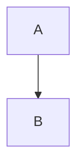

[toc]

# Feature document

Every construct of spec 02 and every block of spec 04 appears here at least once
(spec 20). This line follows a soft break.

Setext heading
==============

Second setext heading
---------------------

## Inline

Text with **strong**, __strong too__, *em*, _em too_, ~~strike~~, `code`, and
***strong em***. A [link](https://example.invalid "Title"), a [reference link][ref],
a collapsed [ref][], an autolink <https://example.invalid/auto>, an extended autolink
www.example.invalid and https://example.invalid/plain, an email <me@example.invalid>.
Entities &amp; &copy; &#169;, escapes \*not em\* and \[not a link\], emoji :smile: and
:+1:, inline HTML <kbd>Ctrl</kbd> and <u>underline</u>, a footnote[^1] and a named
one[^note]. Inline math (off by default) $x^2$ and display-style inline $$y$$.
Hard break with backslash\
and with two spaces  
end of paragraph.

[ref]: https://example.invalid/ref "Reference title"

## Blocks

> A blockquote with **strong**.
>
> > Nested quote.

- Bullet one
- Bullet two
  - Nested bullet
    continued line
- [ ] Task open
- [x] Task done
- [X] Task done (capital)

1. First
2. Second
3. Third

7. Starts at seven
8. Eight

* Star bullet

+ Plus bullet

```js
// fenced code
function add(a, b) {
  return a + b;
}
```

~~~python
print("tilde fence")
~~~

    indented code block
    second line



$$
\int_0^1 x^2 \, dx = \frac{1}{3}
$$

| Left | Center | Right |
| :--- | :----: | ----: |
| a    | b      | c     |
| `x`  | **y**  | 1     |


***

<div class="note">
  <p>An HTML block.</p>
</div>

<!-- an HTML comment block -->

### Heading 3

#### Heading 4

##### Heading 5

###### Heading 6

Last paragraph.

[^1]: The first footnote.
[^note]: A named footnote
    with a continuation line.
